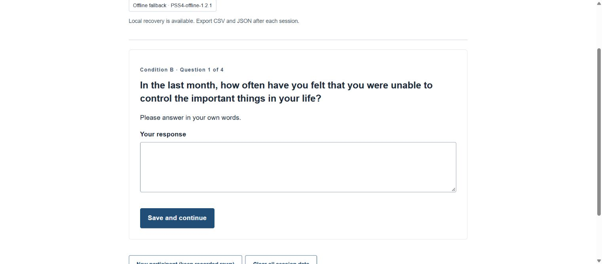
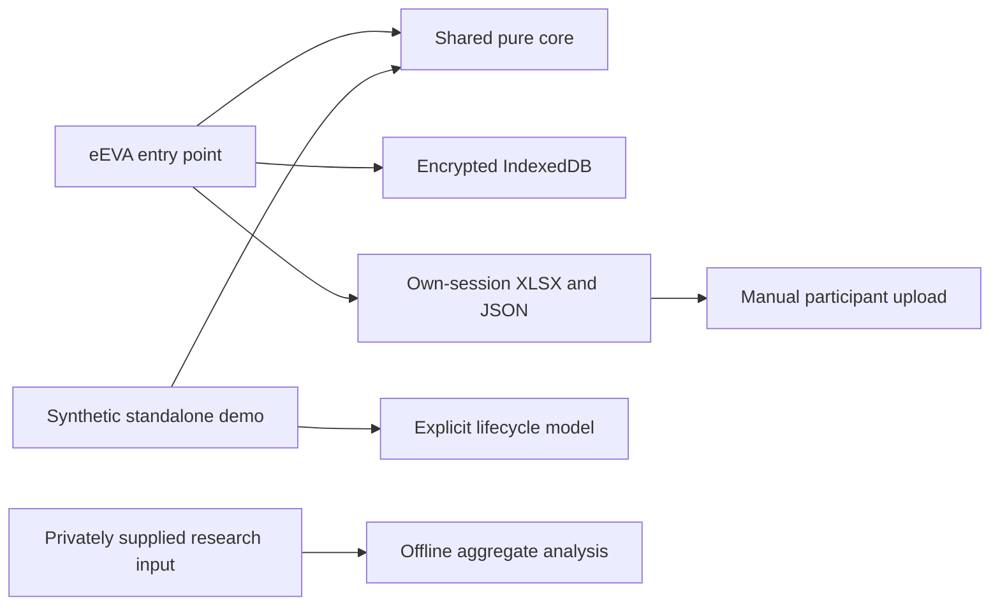

# ClariScale

**Conversational Assessment Platform**

A JavaScript platform for structured questionnaires and conversational assessment workflows. ClariScale uses deterministic frequency rules, one neutral clarification and a structured fallback, with an eEVA/SAGE embodied-agent integration and reproducible pilot analysis.

**Engineering implementation and maintenance: Jai Lnu.** The platform combines inspectable language rules, browser-side experiment orchestration and participant-controlled data exports.

## See it in five minutes



This authentic screenshot shows the historical offline baseline, not the final PSS-10 agent. For the current standalone demonstration:

```sh
git clone https://github.com/JaiKaushik03/clariscale.git
cd clariscale
npm test
npm run demo
# Open http://127.0.0.1:4173
```

Node 22+; Python 3.12+ for analysis. No npm dependencies or install step. The local demo shares mapping/scoring/order logic with the integration, uses fictional responses only, has no avatar and writes no browser persistence. Reload discards progress. It does not emulate institutional deployment.

## Implemented features

- Deterministic English frequency classification into five ordinal categories, with explicit abstention.
- Fixed PSS-10 allocation: A = Q1–5 choices; B = Q6–10 typed answers. Only AB/BA sequence varies.
- eEVA entry point retaining agent motion requests, consent, two SUS forms, local transactional order reservation and encrypted IndexedDB persistence.
- Genuine own-session XLSX export. New post-study JSON backup and export validation, without an aggregate participant endpoint.
- Portable lifecycle model, duplicate-submission guards, scoring/missingness tests, synthetic fixtures and CI.
- Private-input paired statistical analysis and historical mapper replay.

## Architecture



The eEVA adapter preserves its own UI lifecycle. The new independently tested lifecycle model drives the portable demo; it has not replaced the deployed study. No runtime LLM, emotion classifier, camera or microphone interprets answers.

## History and evidence boundaries

| Stage | Location | Meaning |
|---|---|---|
| Historical PSS-4 baseline | Git history | Preserved offline fallback while eEVA was unavailable |
| Participant-study source | provenance/participant-study | Sanitized source snapshot; original order bug remains visible |
| Post-collection order fix | provenance/order-fixed | Requested order passed into reservation; not retroactive |
| Later deployed PSS-10 | source manifest and QA notes | Real native XLSX; JSON absent in that deployed release |
| ClariScale finalization | integrations, demo, test, analysis | New modularization, contracts, JSON backup, tests and documentation |

## Verification

```sh
npm test
npm run test:replay
python -B -m unittest discover -s test -p '*_test.py'
# Requires a privately supplied original CSV, never commit it:
python -B analysis/evaluate.py --input /private/source.csv
# Requires private original baseline rows:
node analysis/replay.cjs /private/baseline_source_rows.json private-replay
```

Tests run with fictional values and an in-memory IndexedDB adapter. CI is configured in [.github/workflows/portable.yml](.github/workflows/portable.yml); no badge substitutes for checking the actual run.

## Data and completion workflow

Historical native sessions were encrypted locally with AES-GCM and an RSA-OAEP wrapped key, in the collecting Chrome profile. This does not synchronize devices or upload to the team. The historical offline fallback did not use this encryption.

The native participant downloads their own unencrypted XLSX, acknowledges the download, opens/copies a configured manual-upload URL, acknowledges upload and sees completion. Acknowledgments are self-reports. The optional new JSON backup does not bypass the required XLSX workflow. Researcher recovery is separate from participant controls.

[Deployment/configuration](integrations/eeva/README.md) requires researcher-provided public encryption configuration and a private upload destination. No actual keys or real upload links are included. Institutional eEVA/SAGE accounts, network or VPN access may be required.

## Pilot findings

Recomputed from the original CSV, not spreadsheet summary caches. Differences are B minus A.

| Measure | Paired n | A mean | B mean | Difference [95% CI] |
|---|---:|---:|---:|---|
| SUS (0–100) | 9 | 89.72 | 75.56 | −14.17 [−31.49, +3.16] |
| Item time (seconds) | 9 | 37.12 | 139.79 | +102.67 [+35.13, +170.22] |

The two subsets differ. B took longer in all nine eligible time pairs. Different question content confounds format, so these are exploratory associations, not causal effects or proof of noninferiority. See [evaluation](docs/evaluation.md) for exclusions, sensitivity analysis and replay. No overall accuracy improvement is supported.

## Engineering contributions

Jai's implementation work spans the JavaScript assessment interface, deterministic mapper integration, requested-order debugging, browser persistence, participant-only exports and regression verification. The current code adds a shared core, versioned export contracts, a portable lifecycle model and private-input statistical tooling.

eEVA/SAGE supplies the 3D agent and framework APIs. ClariScale controls study flow, interpretation, scoring and logs. See the [technical portfolio](docs/portfolio.md) for implementation decisions and measured results.

## Read further

[Architecture](docs/architecture.md) · [Protocol](docs/protocol.md) · [Scoring](docs/scoring.md) · [Contracts](docs/contracts.md) · [Research provenance and attribution](docs/provenance.md) · [Evaluation](docs/evaluation.md) · [Known issues](docs/known-issues.md)

## Responsible use and licensing

Research prototype, not diagnosis or treatment. Never commit response text, individual scores, archives, lookup tables, credentials, private keys or real upload URLs. Use synthetic fixtures. Existing licensing/attribution is preserved; no new license is granted. Redistribution rights for institutional framework assets and questionnaire materials must be checked separately.

AI assistance: ChatGPT/Codex assisted implementation, debugging, tests, documentation and analysis scripting. Authors remain responsible for understanding and checking the work.
